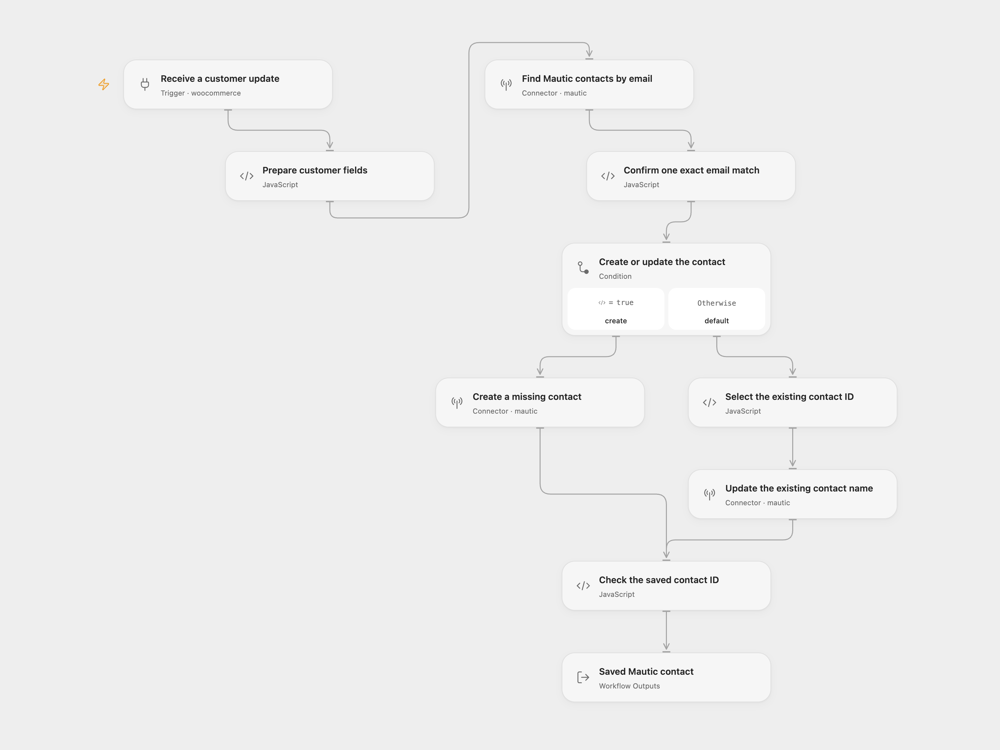

# WooCommerce Customer to Mautic

Create a missing Mautic contact or update its name when a WooCommerce customer changes.

<picture>
  <source media="(prefers-color-scheme: dark)" srcset="preview-dark.png">
  
</picture>

[Open Flow JSON](templates/woocommerce-customer-to-mautic.openflow.json) · [n8n JSON](templates/woocommerce-customer-to-mautic.n8n.json)

## Setup

Connect your WooCommerce store in **Receive a customer update**. Use its HTTPS URL and a REST API consumer key/secret with **Read/Write** access; the associated user must be allowed to manage webhooks. Keep **Events** set to `customer.updated`. Deploy to a public HTTPS callback and activate the workflow to register its signed subscription. The source subscribes to customer updates only, despite its original title.

Connect the same Mautic account in all three Mautic steps. In n8n, use **WooCommerce API** credentials in the trigger and **Mautic API** credentials in the search, create and update nodes. For Mautic, use a public HTTPS instance URL, username and password, enable REST API and Basic authentication, and grant contact view/create/edit permission. Configure email as a unique field. Activate one format for this sync to avoid duplicate processing.

## Behavior

Each customer update validates the email and text fields, then searches Mautic using the email. With no search results, it creates a contact with email, first name, last name and billing company. With one exact email match, it updates only the first and last names. It leaves an existing contact’s company and other fields unchanged. Blank name fields use Mautic’s default behavior of retaining existing nonblank values; keep `overwriteWithBlank` unset.

The search preserves the source’s first-page limit of **30 contacts**. A full page, duplicate exact email matches, or search results without an exact email match stop before any write. Email comparison ignores case and surrounding whitespace. Resolve ambiguous CRM data before replaying; no additional search pages or arbitrary contact selection are added. A successful run returns the full saved contact.

The subscription receives future `customer.updated` events. It does not import existing customers, subscribe to customer-created events, add segments or send campaigns. Open Flow accepts webhook bodies up to **64 KiB**; large custom customer fields must fit that limit. Missing customer fields or search errors prevent writes. A create/update error or missing saved ID stops the run, with no automatic workflow retry. A write with an unknown result may already have changed Mautic; inspect the CRM before replaying. Search followed by write is not an atomic transaction.

Both formats verify fresh subscriptions using WooCommerce’s body signature. Open Flow uses the delivery ID as its trigger deduplication key when present; the native n8n trigger does not add that key. This is not an exactly-once CRM-write guarantee. Webhook acknowledgment confirms receipt, not completion of the later sync.

## Changes to the source

- Repair the create branch’s reference to the nonexistent **Customer Created** node.
- Make the actual customer-updated event, 30-contact search window and raw-contact output explicit.
- Validate the customer before reading Mautic and require an unambiguous exact email match before updating.
- Preserve company mapping for new contacts and name-only updates for existing contacts; check the saved ID in both branches.
- Use the same Mautic Basic authentication configuration in both formats; reconnect the source’s OAuth account accordingly.

Source and license

Adapted from [New WooCommerce Customer to Mautic](https://github.com/Zie619/n8n-workflows/blob/ae8cf6dc5b873cbb4f74587aa9180ed3a9f70682/workflows/Mautic/1160_Mautic_Woocommerce_Create_Triggered.json) in [Zie619/n8n-workflows](https://github.com/Zie619/n8n-workflows). The source export does not identify a separate template author or license.

The collection’s [MIT notice](https://github.com/Zie619/n8n-workflows/blob/94007c1445d9258a7da116646b79473e7c7c3282/LICENSE) is pinned at a later revision. This is the collection notice at that revision; it does not establish a separate original template author's license. Our changes are listed above; see [repository licensing](../../README.md#licensing).

> MIT License
>
> Copyright (c) 2025 Zie619
>
> Permission is hereby granted, free of charge, to any person obtaining a copy
> of this software and associated documentation files (the "Software"), to deal
> in the Software without restriction, including without limitation the rights
> to use, copy, modify, merge, publish, distribute, sublicense, and/or sell
> copies of the Software, and to permit persons to whom the Software is
> furnished to do so, subject to the following conditions:
>
> The above copyright notice and this permission notice shall be included in all
> copies or substantial portions of the Software.
>
> THE SOFTWARE IS PROVIDED "AS IS", WITHOUT WARRANTY OF ANY KIND, EXPRESS OR
> IMPLIED, INCLUDING BUT NOT LIMITED TO THE WARRANTIES OF MERCHANTABILITY,
> FITNESS FOR A PARTICULAR PURPOSE AND NONINFRINGEMENT. IN NO EVENT SHALL THE
> AUTHORS OR COPYRIGHT HOLDERS BE LIABLE FOR ANY CLAIM, DAMAGES OR OTHER
> LIABILITY, WHETHER IN AN ACTION OF CONTRACT, TORT OR OTHERWISE, ARISING FROM,
> OUT OF OR IN CONNECTION WITH THE SOFTWARE OR THE USE OR OTHER DEALINGS IN THE
> SOFTWARE.

