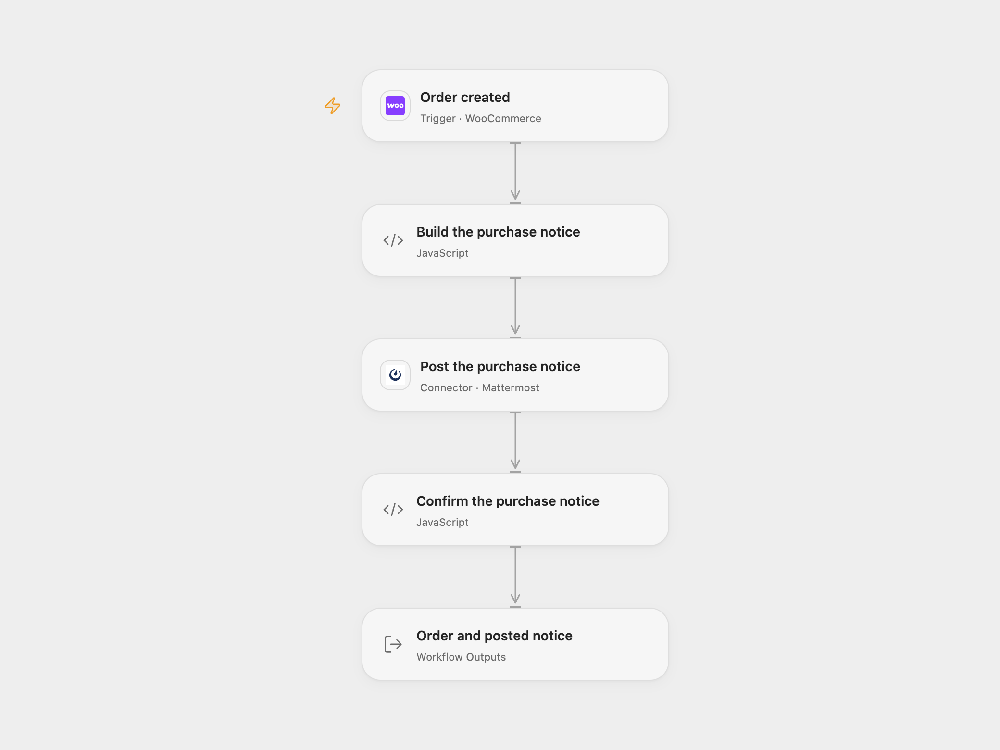

# WooCommerce Order to Mattermost

Post a purchase notice to Mattermost when a new WooCommerce order is created.

<picture>
  <source media="(prefers-color-scheme: dark)" srcset="preview-dark.png">
  
</picture>

[Open Flow JSON](templates/woocommerce-order-mattermost-alert.openflow.json) · [n8n JSON](templates/woocommerce-order-mattermost-alert.n8n.json)

## Setup

Connect WooCommerce in **Order created** with a Read/Write REST API consumer key and secret and a user allowed to manage webhooks. Keep Events set to `order.created`, deploy to a public HTTPS callback and activate the workflow to register its signed subscription.

Set the Mattermost channel ID in **Build the purchase notice**. Connect **Post the purchase notice** to Mattermost with its instance URL and Personal Access Token, and give the account permission to post in that channel. The hosted Connector requires a public HTTPS Mattermost instance; its current outbound guard rejects localhost, private addresses and IPv6 targets.

## Behavior

Each new order sends one message: `<billing first name> bought <first line item name>!`. This preserves the source’s first-item-only notice, including when the order contains more products or quantities. The created event does not confirm payment, shipment or completion; no status filter or extra order update is added. The result keeps the full order and posted Mattermost response.

Missing billing first-name or first-item name fields stop before posting. A failed or uncertain post stops the run without a workflow retry or rollback. The post may already have been accepted; inspect the channel before replaying. Incoming complete order bodies must fit the current Open Flow integration limit of 64 KiB, and Code inputs/results must fit 1 MiB.

The store subscription receives future events rather than importing existing orders. Open Flow uses a delivery ID as its trigger deduplication key when supplied; native n8n does not add that key. This is not an exactly-once message guarantee. Callback acknowledgment confirms receipt, not completion of the later message. Open Flow additionally checks that the signed topic matches the subscription; native n8n trusts the subscription topic after signature verification.

The current Open Flow endpoint returns HTTP 400 to WooCommerce’s unsigned form setup ping and accepts signed JSON order events. Check the registered webhook’s active status and delivery logs after activation. The setup ping does not send a purchase notice.

## n8n

Select WooCommerce API credentials in **Order created**, set the same channel ID in **Build the purchase notice**, and select Mattermost API credentials in **Post the purchase notice**. Activate one format for this notification to avoid duplicate subscriptions. Both formats use signed callbacks for fresh subscriptions. The native Mattermost authentication helper can send a request once more after HTTP 401; Open Flow rejects 401 after one request. Other inspected errors and unknown writes are not automatically repeated by these message transports.

## Changes to the source

- Replace private credentials, webhook identity and destination channel with setup.
- Preserve order.created and the billing-name/first-product message.
- Validate required order fields and confirm the full post response without retrying uncertain writes.

Source and license

Adapted from [Send a message on Mattermost when an order is created in WooCommerce](https://github.com/Zie619/n8n-workflows/blob/ae8cf6dc5b873cbb4f74587aa9180ed3a9f70682/workflows/Mattermost/0294_Mattermost_Woocommerce_Create_Triggered.json) in [Zie619/n8n-workflows](https://github.com/Zie619/n8n-workflows). The source export does not identify a separate template author or license.

The collection’s [MIT notice](https://github.com/Zie619/n8n-workflows/blob/94007c1445d9258a7da116646b79473e7c7c3282/LICENSE) is pinned at a later revision. This is the collection notice at that revision; it does not establish a separate original template author's license. Our changes are listed above; see [repository licensing](../../README.md#licensing).

> MIT License
>
> Copyright (c) 2025 Zie619
>
> Permission is hereby granted, free of charge, to any person obtaining a copy
> of this software and associated documentation files (the "Software"), to deal
> in the Software without restriction, including without limitation the rights
> to use, copy, modify, merge, publish, distribute, sublicense, and/or sell
> copies of the Software, and to permit persons to whom the Software is
> furnished to do so, subject to the following conditions:
>
> The above copyright notice and this permission notice shall be included in all
> copies or substantial portions of the Software.
>
> THE SOFTWARE IS PROVIDED "AS IS", WITHOUT WARRANTY OF ANY KIND, EXPRESS OR
> IMPLIED, INCLUDING BUT NOT LIMITED TO THE WARRANTIES OF MERCHANTABILITY,
> FITNESS FOR A PARTICULAR PURPOSE AND NONINFRINGEMENT. IN NO EVENT SHALL THE
> AUTHORS OR COPYRIGHT HOLDERS BE LIABLE FOR ANY CLAIM, DAMAGES OR OTHER
> LIABILITY, WHETHER IN AN ACTION OF CONTRACT, TORT OR OTHERWISE, ARISING FROM,
> OUT OF OR IN CONNECTION WITH THE SOFTWARE OR THE USE OR OTHER DEALINGS IN THE
> SOFTWARE.

