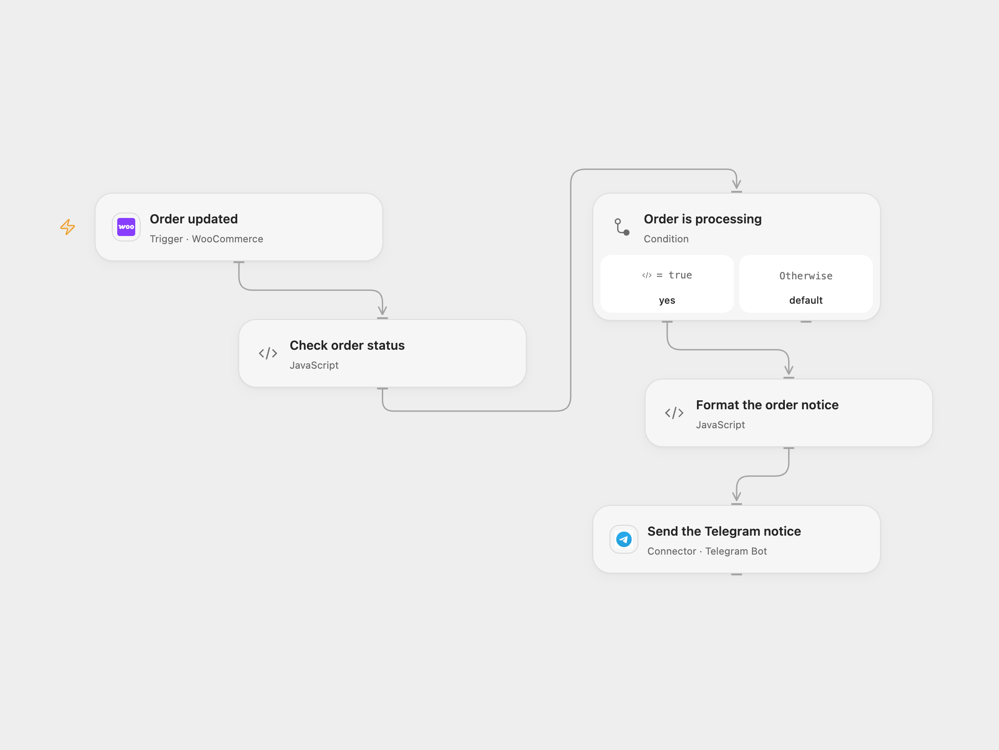

# WooCommerce Processing Orders to Telegram

Send order details to Telegram when an updated WooCommerce order is processing.

<picture>
  <source media="(prefers-color-scheme: dark)" srcset="preview-dark.png">
  
</picture>

[Open Flow JSON](templates/woocommerce-processing-order-to-telegram.openflow.json) · [n8n JSON](templates/woocommerce-processing-order-to-telegram.n8n.json)

## Setup

Connect WooCommerce in **Order updated** using REST API credentials with permission to manage webhooks. Deploy a public HTTPS callback and activate the workflow to register an `order.updated` subscription. Connect the Telegram bot and set the destination chat ID in **Send the Telegram notice**. In n8n, connect the WooCommerce and Telegram credentials and set the chat ID in **Telegram**. Enable one format and remove any older manual subscription to avoid duplicate notices.

## Behavior

Every order update with status `processing` sends one HTML message with the order ID, billing name, total and currency, creation time in UTC, billing city and phone, customer note, and every product name and quantity. The Telegram destination receives customer information; restrict access to the chat. Other statuses produce no message. Repeated updates while an order remains processing can produce repeated notices; this workflow does not detect status transitions or deduplicate orders.

Malformed required fields or an escaped HTML notice longer than 4096 characters stop before Telegram. The Open Flow integration accepts order payloads up to 64 KiB. A failed or uncertain Telegram send is not automatically repeated; check the chat before retrying. The webhook acknowledgment does not confirm that the Telegram message was delivered.

Inspiration &amp; credits

## Changes to the source

- Use a signed WooCommerce subscription in place of the manually configured unsigned webhook.
- Preserve the total's decimal string and show currency, interpret the GMT creation date as UTC, and escape order text for Telegram HTML. Invalid required data stops instead of substituting the current time.
- Remove the n8n-specific attribution footer and require a configured chat ID.

Adapted from [Send Telegram Alerts for New WooCommerce Orders](https://github.com/Zie619/n8n-workflows/blob/ae8cf6dc5b873cbb4f74587aa9180ed3a9f70682/workflows/Webhook/1525_Webhook_Telegram_Create_Webhook.json) in [Zie619/n8n-workflows](https://github.com/Zie619/n8n-workflows). The matching [n8n community listing](https://n8n.io/workflows/2575-notify-on-telegram-when-a-new-order-is-created-in-woocommerce/) credits AmirHossein MnasouriZade. The original template does not state a separate license.

The collection’s [MIT notice](https://github.com/Zie619/n8n-workflows/blob/94007c1445d9258a7da116646b79473e7c7c3282/LICENSE) is pinned at a later revision. This is the collection notice at that revision; it does not establish a separate original template author's license. Our changes are listed above; see [repository licensing](../../README.md#licensing).

> MIT License
>
> Copyright (c) 2025 Zie619
>
> Permission is hereby granted, free of charge, to any person obtaining a copy
> of this software and associated documentation files (the "Software"), to deal
> in the Software without restriction, including without limitation the rights
> to use, copy, modify, merge, publish, distribute, sublicense, and/or sell
> copies of the Software, and to permit persons to whom the Software is
> furnished to do so, subject to the following conditions:
>
> The above copyright notice and this permission notice shall be included in all
> copies or substantial portions of the Software.
>
> THE SOFTWARE IS PROVIDED "AS IS", WITHOUT WARRANTY OF ANY KIND, EXPRESS OR
> IMPLIED, INCLUDING BUT NOT LIMITED TO THE WARRANTIES OF MERCHANTABILITY,
> FITNESS FOR A PARTICULAR PURPOSE AND NONINFRINGEMENT. IN NO EVENT SHALL THE
> AUTHORS OR COPYRIGHT HOLDERS BE LIABLE FOR ANY CLAIM, DAMAGES OR OTHER
> LIABILITY, WHETHER IN AN ACTION OF CONTRACT, TORT OR OTHERWISE, ARISING FROM,
> OUT OF OR IN CONNECTION WITH THE SOFTWARE OR THE USE OR OTHER DEALINGS IN THE
> SOFTWARE.

