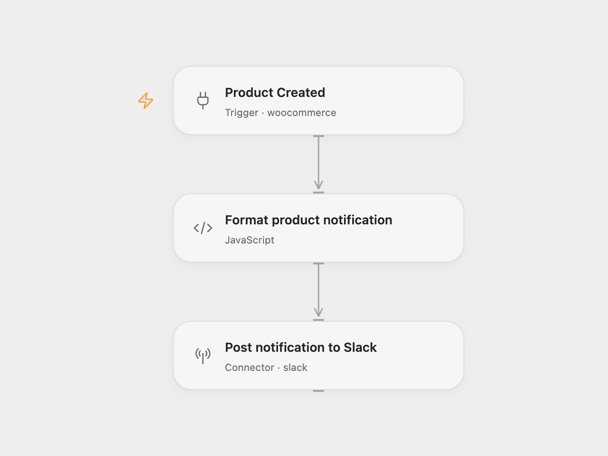

# WooCommerce Product to Slack

Post new WooCommerce product names, prices, and links to Slack.

<picture>
  <source media="(prefers-color-scheme: dark)" srcset="preview-dark.png">
  
</picture>

[Open Flow JSON](templates/woocommerce-product-slack-alert.openflow.json) · [n8n JSON](templates/woocommerce-product-slack-alert.n8n.json)

## Setup

Connect WooCommerce in **Product Created**. The store account must be able to create and manage webhooks. Connect Slack in **Post notification to Slack**, set the destination channel ID, and give that account access to the channel.

For n8n, select WooCommerce credentials in **Product Created** and a Slack account and channel in **Send to Slack**. Activate one format after setup; each activated workflow creates its own store subscription.

Each `product.created` event posts one message with the product name, regular price, sale price, permalink, and the store’s creation timestamp. Empty price strings remain empty, as they can be for products without a set price. The workflow does not retrieve product variations or apply a currency conversion.

The message keeps the source’s colored Slack attachment. Dynamic values are escaped for Slack, and timestamps retain the store’s supplied text. The workflow posts once per matching event and keeps no notification history. Duplicate event deliveries or running both formats can produce duplicate messages. A Slack error fails the run; the workflow does not automatically retry or confirm that a person has read the alert.

Inspiration &amp; credits

## Changes to the source

- Replace the original channel with a setup placeholder.
- Validate the fields used in each alert and escape dynamic Slack values.
- Add an attachment fallback and make the source event and filters explicit.

Adapted from [WooCommerce Product to Slack](https://github.com/Zie619/n8n-workflows/blob/ae8cf6dc5b873cbb4f74587aa9180ed3a9f70682/workflows/Woocommerce/1148_Woocommerce_Slack_Create_Triggered.json) in [Zie619/n8n-workflows](https://github.com/Zie619/n8n-workflows). The source export does not identify a separate template author or license.

The collection’s [MIT notice](https://github.com/Zie619/n8n-workflows/blob/94007c1445d9258a7da116646b79473e7c7c3282/LICENSE) is pinned at a later revision. This is the collection notice at that revision; it does not establish a separate original template author's license. Our changes are listed above; see [repository licensing](../../README.md#licensing).

> MIT License
>
> Copyright (c) 2025 Zie619
>
> Permission is hereby granted, free of charge, to any person obtaining a copy
> of this software and associated documentation files (the "Software"), to deal
> in the Software without restriction, including without limitation the rights
> to use, copy, modify, merge, publish, distribute, sublicense, and/or sell
> copies of the Software, and to permit persons to whom the Software is
> furnished to do so, subject to the following conditions:
>
> The above copyright notice and this permission notice shall be included in all
> copies or substantial portions of the Software.
>
> THE SOFTWARE IS PROVIDED "AS IS", WITHOUT WARRANTY OF ANY KIND, EXPRESS OR
> IMPLIED, INCLUDING BUT NOT LIMITED TO THE WARRANTIES OF MERCHANTABILITY,
> FITNESS FOR A PARTICULAR PURPOSE AND NONINFRINGEMENT. IN NO EVENT SHALL THE
> AUTHORS OR COPYRIGHT HOLDERS BE LIABLE FOR ANY CLAIM, DAMAGES OR OTHER
> LIABILITY, WHETHER IN AN ACTION OF CONTRACT, TORT OR OTHERWISE, ARISING FROM,
> OUT OF OR IN CONNECTION WITH THE SOFTWARE OR THE USE OR OTHER DEALINGS IN THE
> SOFTWARE.

