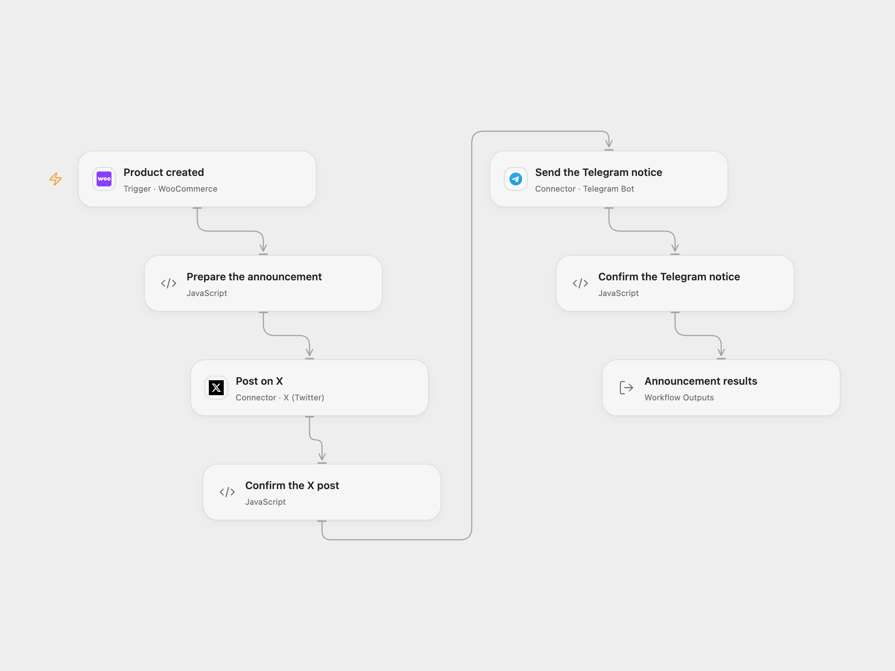

# WooCommerce New Product to X and Telegram

Announce newly created WooCommerce products on X and Telegram using their names and permalinks.

<picture>
  <source media="(prefers-color-scheme: dark)" srcset="preview-dark.png">
  
</picture>

[Open Flow JSON](templates/woocommerce-product-to-x-and-telegram.openflow.json) · [n8n JSON](templates/woocommerce-product-to-x-and-telegram.n8n.json)

## Setup

Connect WooCommerce to **Product created** with REST API Read/Write credentials and permission to manage webhooks. Keep the event product.created, publish the workflow to a public HTTPS callback and activate the signed subscription.

Connect **Post on X** to an X account allowed to post. In **Prepare the announcement**, set the Telegram chat ID, then connect **Send the Telegram notice** to a bot allowed to post there.

In n8n, choose WooCommerce, Twitter OAuth2 and Telegram credentials on the three service nodes and set the same Telegram chat ID in **Prepare the announcement**. Activate one format for this process.

## Behavior

Each product-created event produces the original announcement with its name and permalink. X is posted first, then Telegram. The result retains the product and both post receipts. A missing name or permalink stops before either post.

A failed or uncertain X post stops before Telegram; a failed Telegram post can leave the X post already published. Inspect both destinations before replaying. There is no workflow retry or rollback. The n8n OAuth2 helper can refresh the X token and resend the request once after HTTP 401; inspect X before replaying an uncertain post. Open Flow uses the WooCommerce delivery ID for trigger deduplication when provided; n8n does not add that key. Neither format guarantees exactly-once posting. Callback acknowledgment confirms receipt, not completed posting.

Open Flow requires signed JSON events of at most 64 KiB and checks the topic. Its endpoint rejects WooCommerce's unsigned setup ping with HTTP 400. Configure and verify subscription delivery for your deployment. The native n8n trigger validates the signature but trusts the subscription topic without an additional topic check.

## Changes to the source

- Replace the source account identities and chat ID with setup.
- Keep both notices in source order and check returned post IDs; update the native X node to API v2.
- Send literal product text to Telegram; the native version escapes its HTML mode so special characters do not become formatting.

Source and license

Adapted from [New WooCommerce Product to Twitter and Telegram](https://github.com/Zie619/n8n-workflows/blob/ae8cf6dc5b873cbb4f74587aa9180ed3a9f70682/workflows/Twitter/1165_Twitter_Telegram_Create_Triggered.json) in [Zie619/n8n-workflows](https://github.com/Zie619/n8n-workflows). The source export does not identify a separate template author or license.

The collection’s [MIT notice](https://github.com/Zie619/n8n-workflows/blob/94007c1445d9258a7da116646b79473e7c7c3282/LICENSE) is pinned at a later revision. This is the collection notice at that revision; it does not establish a separate original template author's license. Our changes are listed above; see [repository licensing](../../README.md#licensing).

> MIT License
>
> Copyright (c) 2025 Zie619
>
> Permission is hereby granted, free of charge, to any person obtaining a copy
> of this software and associated documentation files (the "Software"), to deal
> in the Software without restriction, including without limitation the rights
> to use, copy, modify, merge, publish, distribute, sublicense, and/or sell
> copies of the Software, and to permit persons to whom the Software is
> furnished to do so, subject to the following conditions:
>
> The above copyright notice and this permission notice shall be included in all
> copies or substantial portions of the Software.
>
> THE SOFTWARE IS PROVIDED "AS IS", WITHOUT WARRANTY OF ANY KIND, EXPRESS OR
> IMPLIED, INCLUDING BUT NOT LIMITED TO THE WARRANTIES OF MERCHANTABILITY,
> FITNESS FOR A PARTICULAR PURPOSE AND NONINFRINGEMENT. IN NO EVENT SHALL THE
> AUTHORS OR COPYRIGHT HOLDERS BE LIABLE FOR ANY CLAIM, DAMAGES OR OTHER
> LIABILITY, WHETHER IN AN ACTION OF CONTRACT, TORT OR OTHERWISE, ARISING FROM,
> OUT OF OR IN CONNECTION WITH THE SOFTWARE OR THE USE OR OTHER DEALINGS IN THE
> SOFTWARE.

