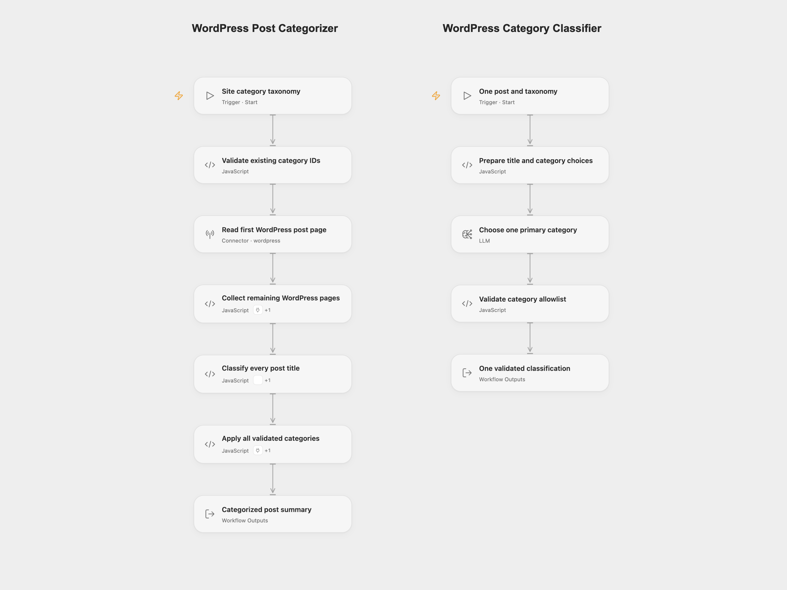

# WordPress Post Categorizer

Classify WordPress post titles into one of your existing categories, validate the whole batch and replace each post’s category assignment.

<picture>
  <source media="(prefers-color-scheme: dark)" srcset="preview-dark.png">
  
</picture>

[Open Flow JSON](templates/wordpress-post-categorizer.openflow.json) · [n8n JSON](templates/wordpress-post-categorizer.n8n.json)

## Setup

The Open Flow JSON contains two workflows, **WordPress Post Categorizer** and **WordPress Category Classifier**. Import the bundle so both are created together. Configure the model service on the classifier, publish that worker, and refresh the `classify-post` workflow capability on **Classify every post title** in the main workflow. Select the imported classifier as its target. The shared file has no published revision; the worker must be configured, published and refreshed before remote execution.

Use the same WordPress account on **Read first WordPress post page** and under Actions in **Collect remaining WordPress pages** and **Apply all validated categories**. The account must be able to read the posts and edit their categories. The model is `gpt-5-mini`, with provider-default generation settings.

OpenAI lists December 11, 2026 as the [shutdown date for `gpt-5-mini`](https://developers.openai.com/api/docs/deprecations/). Select an available model in both formats before that date and recheck category responses and the selected model’s generation settings.

For n8n, choose WordPress credentials on the two native WordPress nodes and an OpenAI credential on **OpenAI Chat Model**. Edit **Set Category Taxonomy** before executing. Its initial `[]` is a placeholder and stops before any post read or update.

## Run

Create the desired categories in WordPress beforehand. Supply `taxonomyJson` as JSON text in the main Open Flow workflow, or the same text in n8n’s settings node. Use the actual IDs from your site. For example, if IDs101 and102 belong to these categories:

```json
[
  { "id": 101, "name": "Content Creation" },
  { "id": 102, "name": "Digital Marketing" }
]
```

The workflow reads the WordPress post collection using its default filters and ordering. It follows the page count reported by WordPress, with ten posts per page, before starting classification. Standard WordPress defaults select published posts, newest first. Correct pagination headers are required for complete coverage; a site that omits the page-count header provides only one page to either format. Keep the collection stable during listing: page-based reads are not an atomic snapshot. Repeated post IDs or malformed titles stop before the model or writes.

Each title is classified once into one configured category. All classifications must complete and pass the allowlist check before any update is attempted. An empty collection returns a zero-count summary. Categories are replaced with exactly one chosen ID; existing category assignments are removed by that replacement. No categories are created, and post content, tags and publication status are not included in the update.

Updates run one at a time in collection order. A failed update stops later updates and leaves earlier changes completed. There are no workflow-level retries or rollback. Each successful rerun reclassifies and replaces categories for the selected collection again. The n8n model adapter permits two additional transient transport retries; Open Flow’s selected model service controls its own transport retry behavior. A failed classification causes no post updates. Large collections remain subject to your platform’s execution and model-service limits.

The result contains the requested `{id, categoryId}` assignments and a count after all update calls succeed. These are the selected assignments, not an independent read-back audit. Post titles and the configured category names are sent to the model service. Choosing a category is a model judgment; review the taxonomy and test on a suitable WordPress site before running across the collection.

## Changes to the source

- Replace the tool-less Agent with an ordinary LLM Chain in n8n and a visible single-post classifier workflow in Open Flow.
- Make the current native model default explicit and preserve the source’s default system message and full title/category prompt.
- Replace the source’s site-specific category IDs with required user configuration.
- Read all reported pages, preserve collection order, and validate the complete batch before updates.
- Reject out-of-taxonomy model responses and send category IDs as numeric arrays.
- Keep read, classification and write phases separate, with explicit empty-collection output and partial-write failure behavior.


## Source and license

Adapted from [Auto-Categorize blog posts in wordpress using A.I.](https://github.com/enescingoz/awesome-n8n-templates/blob/827110332c21cbe000ab13f6d292d5adb1f1f8db/WordPress/Auto-Categorize%20blog%20posts%20in%20wordpress%20using%20A.I..json) in [enescingoz/awesome-n8n-templates](https://github.com/enescingoz/awesome-n8n-templates). The export links to this [case study by Keith Rumjahn](https://rumjahn.com/how-to-use-a-i-to-categorize-wordpress-posts-and-streamline-your-content-organization-process/) and its accompanying [video tutorial](https://www.youtube.com/watch?v=IvQioioVqhw); it does not state a separate template license.

Source collection notice: © 2024–2026 Enes Cingoz, [CC BY 4.0](https://github.com/enescingoz/awesome-n8n-templates/blob/827110332c21cbe000ab13f6d292d5adb1f1f8db/LICENSE). See [repository licensing](../../README.md#licensing) for the scope of OOMOL contributions and third-party material.
