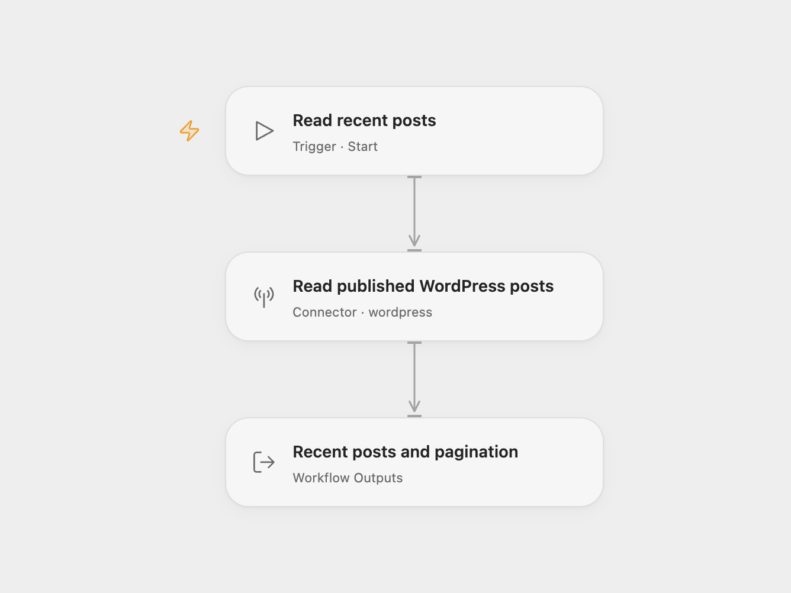

# Recent WordPress Posts

Read up to five published WordPress posts, ordered by publication date with the newest first.

<picture>
  <source media="(prefers-color-scheme: dark)" srcset="preview-dark.png">
  
</picture>

[Open Flow JSON](templates/wordpress-recent-posts.openflow.json) · [n8n JSON](templates/wordpress-recent-posts.n8n.json)

## Setup

Select your WordPress account in **Read published WordPress posts**. Configure the site URL, username and application password in the connection. The site must expose the WordPress REST API. In n8n, choose WordPress credentials in **Wordpress** and run manually.

Each run makes one read request for the first five published posts. It returns complete post objects, including rendered HTML where WordPress provides it. Open Flow also returns the total count and page count from response headers; these values are `null` if the site omits the headers. An empty site returns an empty posts array.

This template reads one page. It does not collect every post, create content or modify the site. Change the limit and filters in the Action or n8n node to read another selection. A failed request stops the run, with no workflow retry configured.

## Changes to the source

- Make the source’s five-post limit and newest-published-post defaults explicit.
- Expose posts and pagination metadata in Open Flow.

Source and license

Adapted from [WordPress post read workflow](https://github.com/Zie619/n8n-workflows/blob/ae8cf6dc5b873cbb4f74587aa9180ed3a9f70682/workflows/Manual/1014_Manual_Wordpress_Automate_Triggered.json) in [Zie619/n8n-workflows](https://github.com/Zie619/n8n-workflows). The source export does not identify a separate template author or license.

The collection’s [MIT notice](https://github.com/Zie619/n8n-workflows/blob/94007c1445d9258a7da116646b79473e7c7c3282/LICENSE) is pinned at a later revision. This is the collection notice at that revision; it does not establish a separate original template author's license. Our changes are listed above; see [repository licensing](../../README.md#licensing).

> MIT License
>
> Copyright (c) 2025 Zie619
>
> Permission is hereby granted, free of charge, to any person obtaining a copy
> of this software and associated documentation files (the "Software"), to deal
> in the Software without restriction, including without limitation the rights
> to use, copy, modify, merge, publish, distribute, sublicense, and/or sell
> copies of the Software, and to permit persons to whom the Software is
> furnished to do so, subject to the following conditions:
>
> The above copyright notice and this permission notice shall be included in all
> copies or substantial portions of the Software.
>
> THE SOFTWARE IS PROVIDED "AS IS", WITHOUT WARRANTY OF ANY KIND, EXPRESS OR
> IMPLIED, INCLUDING BUT NOT LIMITED TO THE WARRANTIES OF MERCHANTABILITY,
> FITNESS FOR A PARTICULAR PURPOSE AND NONINFRINGEMENT. IN NO EVENT SHALL THE
> AUTHORS OR COPYRIGHT HOLDERS BE LIABLE FOR ANY CLAIM, DAMAGES OR OTHER
> LIABILITY, WHETHER IN AN ACTION OF CONTRACT, TORT OR OTHERWISE, ARISING FROM,
> OUT OF OR IN CONNECTION WITH THE SOFTWARE OR THE USE OR OTHER DEALINGS IN THE
> SOFTWARE.

