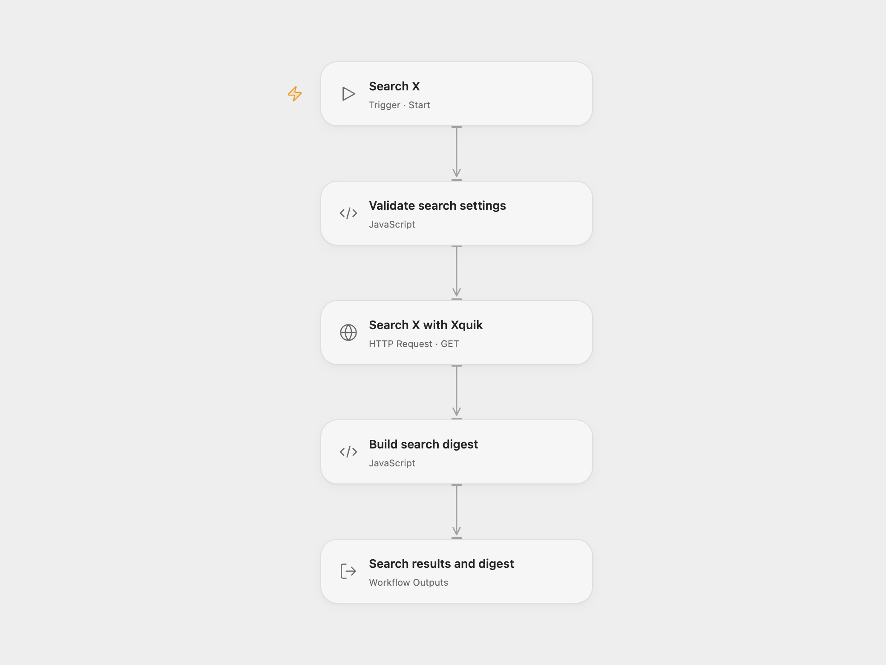

# X Search Digest

Run a query through Xquik and receive normalized X posts with a plain-text digest. The workflow reads one response and returns its pagination flag and cursor.

<picture>
  <source media="(prefers-color-scheme: dark)" srcset="preview-dark.png">
  
</picture>

[Open Flow JSON](templates/x-search-digest.openflow.json) · [n8n JSON](templates/x-search-digest.n8n.json)

## Setup

In Open Flow, import the JSON and bind **Search X with Xquik → Authentication token** to a secret Variable containing your Xquik API key. The template leaves this value empty. Enter `query` and `limit` when starting the workflow, for example `n8n automation` and `10`.

In n8n, edit **Search Settings**. Create a Header Auth credential with name `X-API-Key` and your Xquik key as its value, then select it on **Search X with Xquik**. Run **Manual Trigger**.

Use a nonempty query of up to 4,096 characters and an integer limit from 1 to 10,000. Xquik recommends keeping queries within 512 characters; larger or expensive searches may fail or return fewer rows because of service limits or available quota. See the [official API specification](https://xquik.com/openapi.json) for current search behavior.

## Results

- `tweets` contains each returned post's `id`, `url`, `text`, `author`, `created_at`, and `metrics`.
- `digest` numbers posts in response order and separates them with blank lines. No matches returns `No matching X posts found for this query.`
- `results_count`, `has_more`, and `next_cursor` describe this response. The workflow does not follow the cursor or claim to retrieve every match.

Each run makes one search request, with a 120-second task/request timeout and no workflow retry. HTTP failures or malformed responses stop the run. A repeated run performs another search; there is no saved watermark, deduplication, posting, or model call.

Inspiration &amp; credits

## Changes to the source

- Store the API key in the platform's secret configuration instead of an environment expression.
- Validate the query and limit before searching, and reject malformed responses instead of reporting them as no matches.
- Read the current Xquik `has_next_page`, `createdAt`, and metric fields while retaining the source's older field aliases.
- Use real line breaks in the digest.

Adapted from [Monitor X Search with Xquik](https://github.com/enescingoz/awesome-n8n-templates/blob/827110332c21cbe000ab13f6d292d5adb1f1f8db/Instagram_Twitter_Social_Media/Monitor%20X%20Search%20with%20Xquik.json) in [enescingoz/awesome-n8n-templates](https://github.com/enescingoz/awesome-n8n-templates).

Source collection notice: © 2024–2026 Enes Cingoz, [CC BY 4.0](https://github.com/enescingoz/awesome-n8n-templates/blob/827110332c21cbe000ab13f6d292d5adb1f1f8db/LICENSE). The source export does not identify a separate template author or license. This adaptation includes the changes listed above; see [repository licensing](../../README.md#licensing) for the scope of OOMOL contributions and third-party material.

