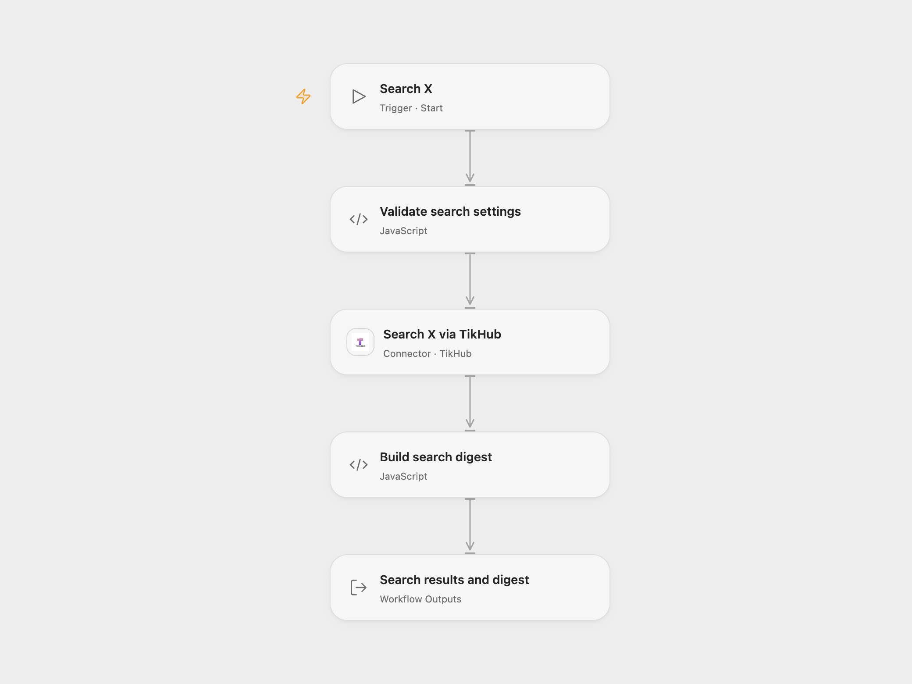

# X Search Digest

Search X once via TikHub and receive normalized X posts with a plain-text digest. The workflow reads one response and returns its pagination flag and cursor.

<!-- template-actions:start -->
 
<!-- template-actions:end -->

<picture>
  <source media="(prefers-color-scheme: dark)" srcset="preview-dark.png">
  
</picture>

## Setup

Connect TikHub in **Search X via TikHub** (via OOMOL-provided access or your TikHub API token). Enter `query` and `limit` when starting the workflow, for example `n8n automation` and `10`.

Use a nonempty query of up to 4,096 characters and an integer limit from 1 to 10,000.

## Behavior

- `tweets` contains each returned post's `id`, `url`, `text`, `author`, `created_at`, and `metrics`.
- `digest` numbers posts in response order and separates them with blank lines. No matches returns `No matching X posts found for this query.`
- `results_count`, `has_more`, and `next_cursor` describe this response. The workflow does not follow the cursor or claim to retrieve every match.

Each run makes one search request with no workflow retry. Connector failures or malformed responses stop the run. A repeated run performs another search; there is no saved watermark, deduplication, posting, or model call.

In n8n

Edit **Search Settings**. Create a Header Auth credential with name `X-API-Key` and your Xquik key as its value, then select it on **Search X with Xquik**. Run **Manual Trigger**. Xquik recommends keeping queries within 512 characters and uses a 120-second request timeout.

Inspiration &amp; credits

## Changes to the source

- Use the TikHub Connector for X search in Open Flow, and store the Xquik API key in n8n's Header Auth credential instead of an environment expression.
- Validate the query and limit before searching, and reject malformed responses instead of reporting them as no matches.
- Normalize returned posts, metrics, and pagination fields while using real line breaks in the digest.

Adapted from [Monitor X Search with Xquik](https://github.com/enescingoz/awesome-n8n-templates/blob/827110332c21cbe000ab13f6d292d5adb1f1f8db/Instagram_Twitter_Social_Media/Monitor%20X%20Search%20with%20Xquik.json) in [enescingoz/awesome-n8n-templates](https://github.com/enescingoz/awesome-n8n-templates).

Source collection notice: © 2024–2026 Enes Cingoz, [CC BY 4.0](https://github.com/enescingoz/awesome-n8n-templates/blob/827110332c21cbe000ab13f6d292d5adb1f1f8db/LICENSE). The source export does not identify a separate template author or license. This adaptation includes the changes listed above; see [repository licensing](../../README.md#licensing) for the scope of OOMOL contributions and third-party material.

