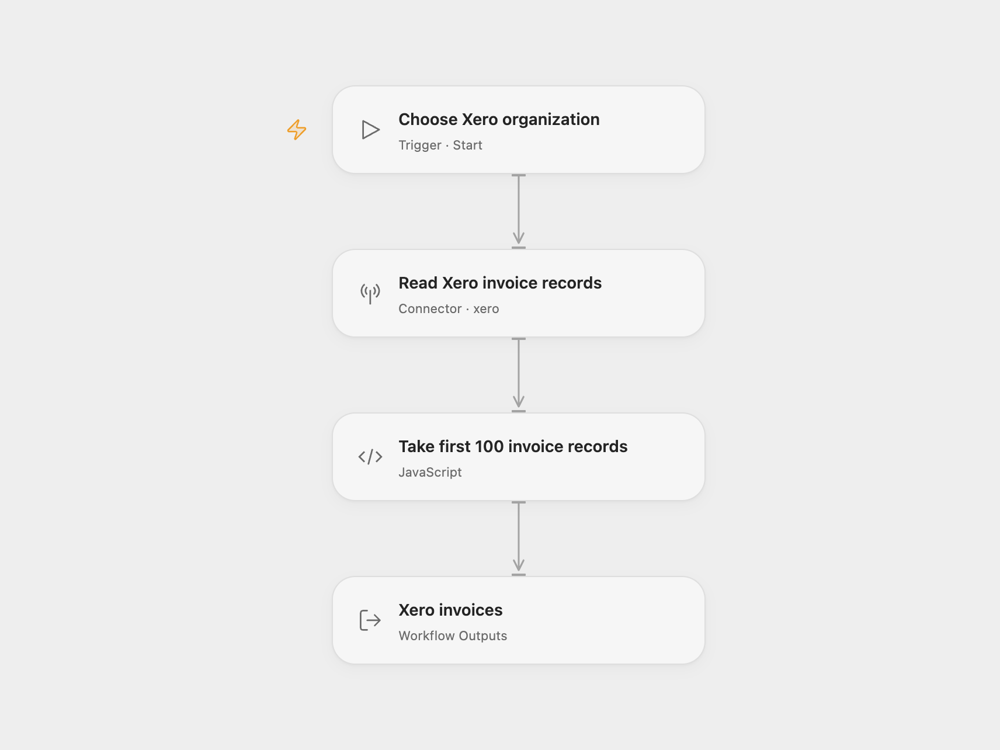

# Xero Invoice Reader

Read up to 100 invoice records from a connected Xero organization.

<picture>
  <source media="(prefers-color-scheme: dark)" srcset="preview-dark.png">
  
</picture>

[Open Flow JSON](templates/xero-invoice-reader.openflow.json) · [n8n JSON](templates/xero-invoice-reader.n8n.json)

## Setup

Select your Xero OAuth account in **Read Xero invoice records** and grant **Provider API** permission, which is separate from individual Action permissions. The connection needs permission to read invoices for the selected organization. Run with **Tenant Id**, the connected organization’s UUID. In n8n, select Xero OAuth2 credentials and choose your organization in **Xero**.

Each run makes one invoice-list request without pagination or filters, and returns its first 100 records in the order supplied by Xero. Invoice properties, nested objects and null values are preserved as returned. This unpaged endpoint returns a contact summary and omits detailed line items. It can transfer more than 100 records before the workflow applies its limit, and Xero rejects requests that would return more than 100,000 invoices. It does not return every invoice or guarantee a newest-first order.

The Open Flow template uses the Xero Provider API to retain these original invoice records. It does not substitute the normalized invoice summaries returned by the invoice search Action. An organization with no invoices returns an empty array. A failed request or invalid response stops the run. The workflow makes no accounting changes and has no automatic retry.

## Changes to the source

- Replace the example organization with user configuration.
- Make the source’s invoice resource and 100-record limit explicit.
- Expose the original invoice records as an Open Flow output.

Source and license

Adapted from [Xero invoice read workflow](https://github.com/Zie619/n8n-workflows/blob/ae8cf6dc5b873cbb4f74587aa9180ed3a9f70682/workflows/Manual/1011_Manual_Xero_Automate_Triggered.json) in [Zie619/n8n-workflows](https://github.com/Zie619/n8n-workflows). The source export does not identify a separate template author or license.

The collection’s [MIT notice](https://github.com/Zie619/n8n-workflows/blob/94007c1445d9258a7da116646b79473e7c7c3282/LICENSE) is pinned at a later revision. This is the collection notice at that revision; it does not establish a separate original template author's license. Our changes are listed above; see [repository licensing](../../README.md#licensing).

> MIT License
>
> Copyright (c) 2025 Zie619
>
> Permission is hereby granted, free of charge, to any person obtaining a copy
> of this software and associated documentation files (the "Software"), to deal
> in the Software without restriction, including without limitation the rights
> to use, copy, modify, merge, publish, distribute, sublicense, and/or sell
> copies of the Software, and to permit persons to whom the Software is
> furnished to do so, subject to the following conditions:
>
> The above copyright notice and this permission notice shall be included in all
> copies or substantial portions of the Software.
>
> THE SOFTWARE IS PROVIDED "AS IS", WITHOUT WARRANTY OF ANY KIND, EXPRESS OR
> IMPLIED, INCLUDING BUT NOT LIMITED TO THE WARRANTIES OF MERCHANTABILITY,
> FITNESS FOR A PARTICULAR PURPOSE AND NONINFRINGEMENT. IN NO EVENT SHALL THE
> AUTHORS OR COPYRIGHT HOLDERS BE LIABLE FOR ANY CLAIM, DAMAGES OR OTHER
> LIABILITY, WHETHER IN AN ACTION OF CONTRACT, TORT OR OTHERWISE, ARISING FROM,
> OUT OF OR IN CONNECTION WITH THE SOFTWARE OR THE USE OR OTHER DEALINGS IN THE
> SOFTWARE.

