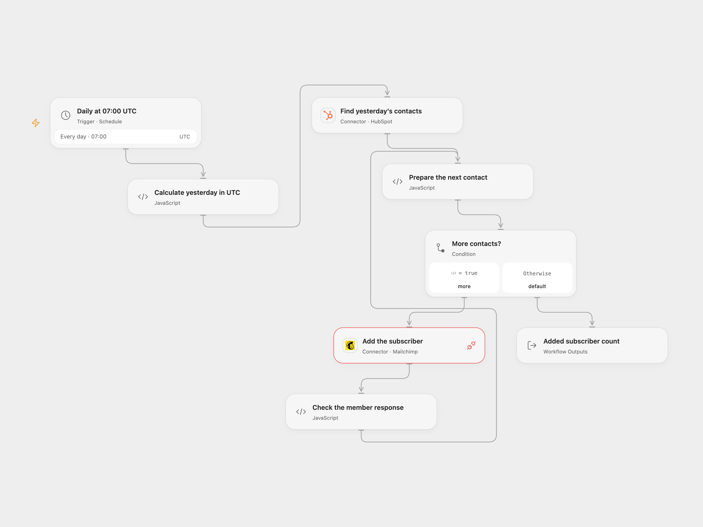

# Yesterday’s HubSpot Contacts to Mailchimp

Add up to 100 HubSpot contacts created yesterday to a Mailchimp audience.

<picture>
  <source media="(prefers-color-scheme: dark)" srcset="preview-dark.png">
  
</picture>

[Open Flow JSON](templates/yesterday-hubspot-contacts-to-mailchimp.openflow.json) · [n8n JSON](templates/yesterday-hubspot-contacts-to-mailchimp.n8n.json)

## Setup

Connect HubSpot in **Find yesterday’s contacts** with contact read and search permission. Connect Mailchimp in **Add the subscriber** and grant Provider API permission; enter the audience ID in **Prepare the next contact**. The audience needs `FNAME` and `LNAME` merge fields. Configure HubSpot OAuth2 credentials, Mailchimp OAuth2 credentials and the same audience in n8n. Enable one format only.

Only use contacts who have agreed to receive marketing. This workflow directly sets `subscribed` and does not run a confirmation signup flow.

## Behavior

Each day the workflow searches contacts created from yesterday 00:00 inclusive to today 00:00 exclusive in UTC. Like the source, it retrieves at most 100 contacts in descending creation time; it does not process older matches beyond that limit. It sends each returned contact’s email, first name and last name to Mailchimp in order. Missing or non-text email, first name or last name stops before writes. An empty result causes no Mailchimp requests.

The original schedule and date window used the n8n instance timezone. Both formats use UTC and run at 07:00 as a starting point; review your timezone before enabling. n8n Cron V1 uses a fixed randomized second, while Open Flow runs on the minute boundary. The window is calculated at execution time.

An existing audience member causes an error rather than an update. Earlier additions remain if a later request fails; inspect Mailchimp before rerunning an uncertain request. No automatic retry or rollback is configured. HubSpot search indexing can delay newly created contacts, so a late-indexed contact may miss its window.

## Changes to the source

- Remove the private audience and credentials; require user configuration and validate contact fields before writing.
- Use explicit UTC for the schedule and date boundaries. Keep the source search limit and create-only behavior.

Source and license

Adapted from [Add new contacts from HubSpot to the email list in Mailchimp](https://github.com/Zie619/n8n-workflows/blob/ae8cf6dc5b873cbb4f74587aa9180ed3a9f70682/workflows/Hubspot/0243_HubSpot_Mailchimp_Create_Scheduled.json) in [Zie619/n8n-workflows](https://github.com/Zie619/n8n-workflows). The matching [n8n community listing](https://n8n.io/workflows/1770-add-new-contacts-from-hubspot-to-the-email-list-in-mailchimp/) credits n8n Team. The original template does not state a separate license.

The collection’s [MIT notice](https://github.com/Zie619/n8n-workflows/blob/94007c1445d9258a7da116646b79473e7c7c3282/LICENSE) is pinned at a later revision. This is the collection notice at that revision; it does not establish a separate original template author's license. Our changes are listed above; see [repository licensing](../../README.md#licensing).

> MIT License
>
> Copyright (c) 2025 Zie619
>
> Permission is hereby granted, free of charge, to any person obtaining a copy
> of this software and associated documentation files (the "Software"), to deal
> in the Software without restriction, including without limitation the rights
> to use, copy, modify, merge, publish, distribute, sublicense, and/or sell
> copies of the Software, and to permit persons to whom the Software is
> furnished to do so, subject to the following conditions:
>
> The above copyright notice and this permission notice shall be included in all
> copies or substantial portions of the Software.
>
> THE SOFTWARE IS PROVIDED "AS IS", WITHOUT WARRANTY OF ANY KIND, EXPRESS OR
> IMPLIED, INCLUDING BUT NOT LIMITED TO THE WARRANTIES OF MERCHANTABILITY,
> FITNESS FOR A PARTICULAR PURPOSE AND NONINFRINGEMENT. IN NO EVENT SHALL THE
> AUTHORS OR COPYRIGHT HOLDERS BE LIABLE FOR ANY CLAIM, DAMAGES OR OTHER
> LIABILITY, WHETHER IN AN ACTION OF CONTRACT, TORT OR OTHERWISE, ARISING FROM,
> OUT OF OR IN CONNECTION WITH THE SOFTWARE OR THE USE OR OTHER DEALINGS IN THE
> SOFTWARE.

