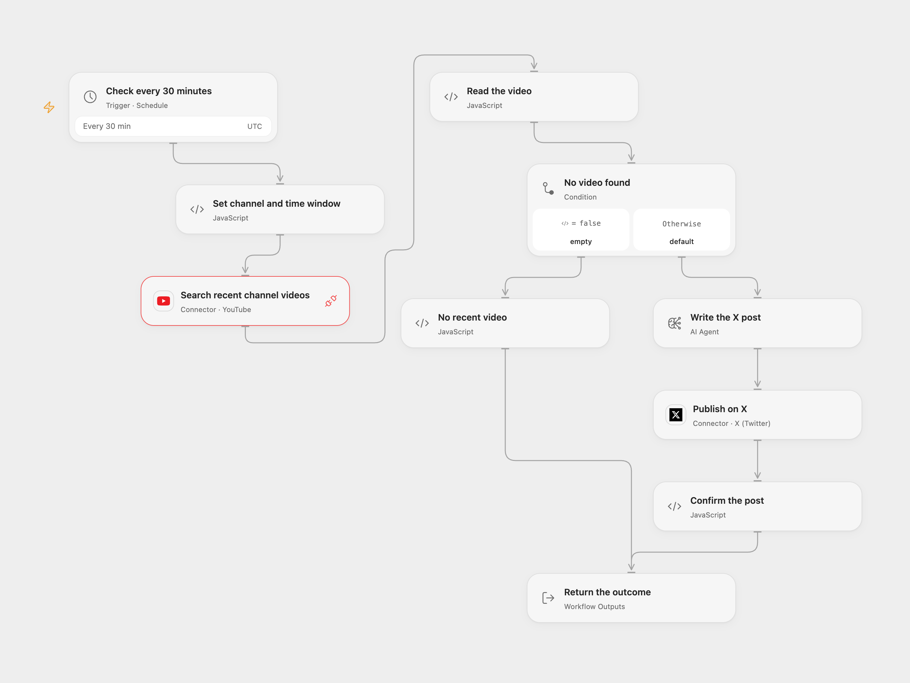

# New YouTube Video to X

Check a YouTube channel every 30 minutes and publish an AI-written X post when the search returns a recent video.

<picture>
  <source media="(prefers-color-scheme: dark)" srcset="preview-dark.png">
  
</picture>

[Open Flow JSON](templates/youtube-new-video-to-x.openflow.json) · [n8n JSON](templates/youtube-new-video-to-x.n8n.json)

## Setup and use

Connect YouTube with read access and X with permission to create posts. Set your channel ID in **Set channel and time window**, configure the AI model and choose a schedule timezone. The default gpt-4o-mini snapshot has an announced January 14, 2027 shutdown; check the active model route and choose an available replacement. In n8n, set the channel on **Fetch Latest Videos**. The source tutorial is available at [mrc.fm/ai2x](https://mrc.fm/ai2x).

Each run searches videos from the channel created in the preceding 30 minutes, with a limit of one. The search retains YouTube's default relevance order; it does not guarantee the newest result. YouTube indexing delays, multiple uploads in one window, downtime or overlapping runs can cause missed or duplicate announcements. No persistent deduplication or catch-up is included. Open Flow fires on the minute in UTC by default; n8n uses its workflow timezone and a fixed registration-time second. Open Flow returns posted:false for an empty result; n8n ends without a post.

The model is asked to include the video URL and write at most 140 characters. This is a prompt, not a programmatic check; review generated posts and confirm your account settings before enabling the schedule. Open Flow stops on malformed video fields; the source n8n path uses its own node and expression behavior. X may reject a post. Open Flow checks the returned post ID and does not retry posting. The n8n credential helper may refresh and resend on an authentication failure. Inspect X before replaying an uncertain post.

Inspiration &amp; credits

## Changes to the source

- Replace the original channel ID with a placeholder and use a configurable current model.
- Open Flow calls the YouTube Connection through its official Proxy because the catalog Search Action requires a query term; the source query has none. Both formats use the same channel, window, type and limit.

Adapted from [Post New YouTube Videos to X](https://github.com/enescingoz/awesome-n8n-templates/blob/827110332c21cbe000ab13f6d292d5adb1f1f8db/Instagram_Twitter_Social_Media/Post%20New%20YouTube%20Videos%20to%20X.json) in [enescingoz/awesome-n8n-templates](https://github.com/enescingoz/awesome-n8n-templates).

Source collection notice: © 2024–2026 Enes Cingoz, [CC BY 4.0](https://github.com/enescingoz/awesome-n8n-templates/blob/827110332c21cbe000ab13f6d292d5adb1f1f8db/LICENSE). The source export does not identify a separate template author or license. See [repository licensing](../../README.md#licensing) for the scope of OOMOL contributions and third-party material.

