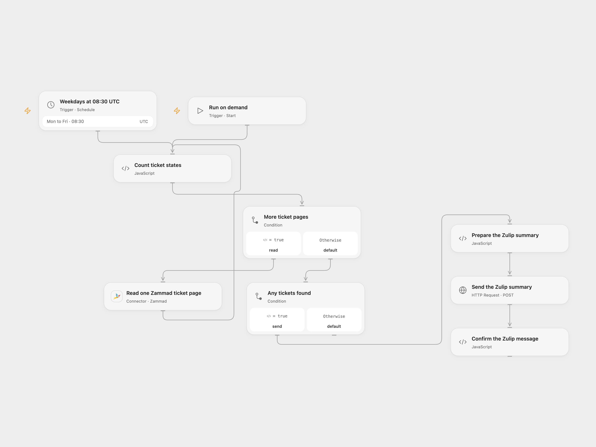

# Zammad Ticket Summary to Zulip

Count Zammad tickets by state and post a support summary to Zulip.

<picture>
  <source media="(prefers-color-scheme: dark)" srcset="preview-dark.png">
  
</picture>

[Open Flow JSON](templates/zammad-ticket-summary-to-zulip.openflow.json) · [n8n JSON](templates/zammad-ticket-summary-to-zulip.n8n.json)

## Setup

Connect Zammad in **Read one Zammad ticket page** with access to the relevant tickets. The Zammad connection URL must resolve to a public IPv4 address for the Connector. In **Count ticket states**, verify the IDs for new, open, pending reminder and pending close; the starting values are 1, 2, 3 and 7. Zammad state IDs can differ between installations. Set your Zulip channel and topic in **Prepare the Zulip summary**.

In **Send the Zulip summary**, replace the example URL with your Zulip server’s HTTPS `/api/v1/messages` URL. Create secret Variables for the bot email and API key and bind them to the HTTP Basic authentication username and password. In n8n, connect Zammad and Zulip credentials, set the channel and topic in **Notify for Standup**, and update the four IDs in **Ticket Filtering** to match your Zammad instance.

Run manually or activate the weekday schedule. Both formats start at 08:30 UTC, while the source used the n8n instance timezone; check the intended timezone before activation.

## Behavior

The workflow reads every page of tickets visible to the Zammad account and counts the four configured state IDs. Other states are excluded from the counts. It posts one summary after all pages are read; no visible tickets means no message. The counts reflect the account’s permissions, and changes during pagination can affect results. Large ticket collections must fit the execution platform’s state limits; a failed page or duplicate ticket stops before posting.

A Zulip failure stops the run. An uncertain post may already have arrived, so check the channel before retrying.

Inspiration &amp; credits

## Changes to the source

- Fix the source’s execute-once setting so all returned tickets are counted.
- Make the state IDs, Zulip destination and timezone explicit; check the Zulip response.

Adapted from [Zammad Open Tickets](https://github.com/Zie619/n8n-workflows/blob/ae8cf6dc5b873cbb4f74587aa9180ed3a9f70682/workflows/Manual/0975_Manual_Zulip_Automation_Scheduled.json) in [Zie619/n8n-workflows](https://github.com/Zie619/n8n-workflows). The source export does not identify a separate template author or license.

The collection’s [MIT notice](https://github.com/Zie619/n8n-workflows/blob/94007c1445d9258a7da116646b79473e7c7c3282/LICENSE) is pinned at a later revision. This is the collection notice at that revision; it does not establish a separate original template author's license. Our changes are listed above; see [repository licensing](../../README.md#licensing).

> MIT License
>
> Copyright (c) 2025 Zie619
>
> Permission is hereby granted, free of charge, to any person obtaining a copy
> of this software and associated documentation files (the "Software"), to deal
> in the Software without restriction, including without limitation the rights
> to use, copy, modify, merge, publish, distribute, sublicense, and/or sell
> copies of the Software, and to permit persons to whom the Software is
> furnished to do so, subject to the following conditions:
>
> The above copyright notice and this permission notice shall be included in all
> copies or substantial portions of the Software.
>
> THE SOFTWARE IS PROVIDED "AS IS", WITHOUT WARRANTY OF ANY KIND, EXPRESS OR
> IMPLIED, INCLUDING BUT NOT LIMITED TO THE WARRANTIES OF MERCHANTABILITY,
> FITNESS FOR A PARTICULAR PURPOSE AND NONINFRINGEMENT. IN NO EVENT SHALL THE
> AUTHORS OR COPYRIGHT HOLDERS BE LIABLE FOR ANY CLAIM, DAMAGES OR OTHER
> LIABILITY, WHETHER IN AN ACTION OF CONTRACT, TORT OR OTHERWISE, ARISING FROM,
> OUT OF OR IN CONNECTION WITH THE SOFTWARE OR THE USE OR OTHER DEALINGS IN THE
> SOFTWARE.

A matching [n8n community listing](https://n8n.io/workflows/1575-update-people-through-zulip-about-open-tickets-in-zammad/) credits Ghazi Triki.

