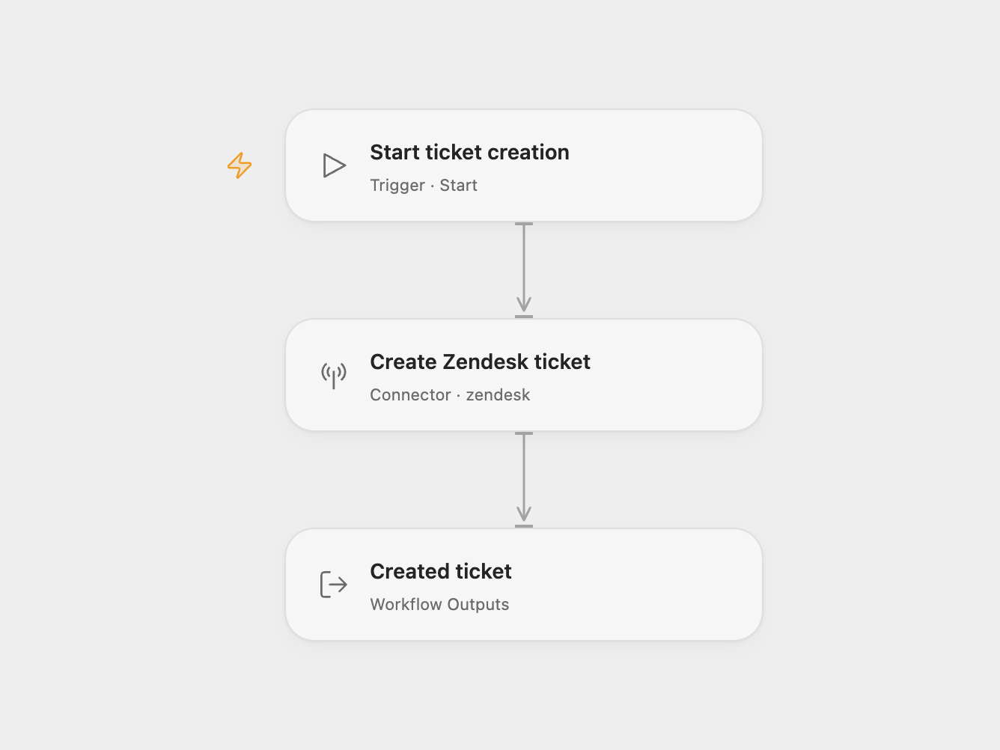

# Zendesk Ticket Creator

Create one Zendesk support ticket with a subject and initial comment.

<picture>
  <source media="(prefers-color-scheme: dark)" srcset="preview-dark.png">
  
</picture>

[Open Flow JSON](templates/zendesk-ticket-creator.openflow.json) · [n8n JSON](templates/zendesk-ticket-creator.n8n.json)

## Setup

Select a Zendesk agent account in **Create Zendesk ticket** and replace the subject and description. The description becomes the initial ticket comment. In n8n, select Zendesk OAuth2 credentials in **Zendesk** and edit its description and subject. Run manually after setup.

The workflow creates one ticket and returns the result. Open Flow returns the current Action’s ticket fields and the original API record under `raw`; n8n returns the original API ticket. The template leaves requester, assignee, status, priority and comment visibility to the service defaults. Account rules and triggers may send notifications or make other ticket changes.

Each manual run creates another ticket. There is no search, upsert or duplicate detection. A service error stops the workflow without an automatic retry. If a creation request times out, check the service before running it again.

## Changes to the source

- Replace the empty description with a setup placeholder.
- Add an explicit subject in both formats, as required by the current Open Flow Action. The source left the subject unset.
- Use n8n’s current Zendesk OAuth2 setup and expose the created ticket.

## Source and license

Adapted from [Create a ticket in Zendesk](https://github.com/Zie619/n8n-workflows/blob/ae8cf6dc5b873cbb4f74587aa9180ed3a9f70682/workflows/Manual/0100_Manual_Zendesk_Create_Triggered.json) in [Zie619/n8n-workflows](https://github.com/Zie619/n8n-workflows). The source export does not identify a separate template author or license.

The collection’s [MIT notice](https://github.com/Zie619/n8n-workflows/blob/94007c1445d9258a7da116646b79473e7c7c3282/LICENSE) is pinned at a later revision. This is the collection notice at that revision; it does not establish a separate original template author's license. Our changes are listed above; see [repository licensing](../../README.md#licensing).

> MIT License
>
> Copyright (c) 2025 Zie619
>
> Permission is hereby granted, free of charge, to any person obtaining a copy
> of this software and associated documentation files (the "Software"), to deal
> in the Software without restriction, including without limitation the rights
> to use, copy, modify, merge, publish, distribute, sublicense, and/or sell
> copies of the Software, and to permit persons to whom the Software is
> furnished to do so, subject to the following conditions:
>
> The above copyright notice and this permission notice shall be included in all
> copies or substantial portions of the Software.
>
> THE SOFTWARE IS PROVIDED "AS IS", WITHOUT WARRANTY OF ANY KIND, EXPRESS OR
> IMPLIED, INCLUDING BUT NOT LIMITED TO THE WARRANTIES OF MERCHANTABILITY,
> FITNESS FOR A PARTICULAR PURPOSE AND NONINFRINGEMENT. IN NO EVENT SHALL THE
> AUTHORS OR COPYRIGHT HOLDERS BE LIABLE FOR ANY CLAIM, DAMAGES OR OTHER
> LIABILITY, WHETHER IN AN ACTION OF CONTRACT, TORT OR OTHERWISE, ARISING FROM,
> OUT OF OR IN CONNECTION WITH THE SOFTWARE OR THE USE OR OTHER DEALINGS IN THE
> SOFTWARE.
