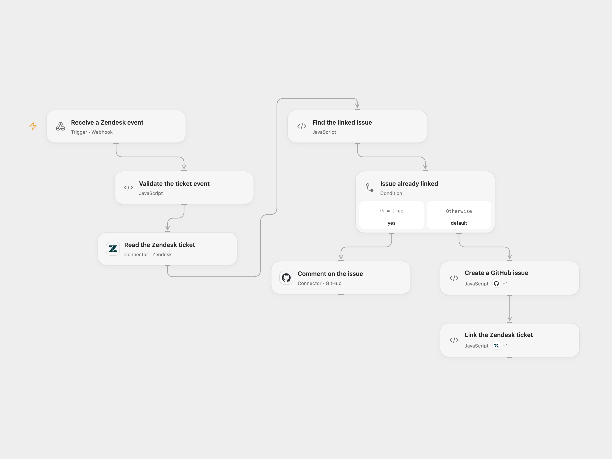

# Create or Comment on GitHub Issues from Zendesk

Create a GitHub issue for a Zendesk ticket or add a comment to its linked issue.

<picture>
  <source media="(prefers-color-scheme: dark)" srcset="preview-dark.png">
  
</picture>

[Open Flow JSON](templates/zendesk-ticket-to-github-issue.openflow.json) · [n8n JSON](templates/zendesk-ticket-to-github-issue.n8n.json)

## Setup

Create a Zendesk ticket custom field that stores a GitHub issue number. In **Validate the ticket event**, set its numeric field ID and the GitHub repository owner and name. Connect Zendesk in **Read the Zendesk ticket** and its Action in **Link the Zendesk ticket**, using the same account with ticket read and update access. Connect GitHub in **Comment on the issue** and its Action in **Create a GitHub issue**, using an account that can create issues and comments in that repository. The Zendesk read Action also reads ticket comments.

Create an Open Flow secret Variable named ZENDESK_GITHUB_SECRET with at least 24 unpredictable characters and bind it to the secret input of **Validate the ticket event**. Configure the Zendesk webhook sender to POST JSON containing the ticket ID in id, the comment text in comment, and the shared value in secret. The shared value is a bearer secret; restrict access to the sender, endpoint and execution history, and use HTTPS. In n8n, configure the same field ID and repository in **Validate the ticket event**, credentials on the Zendesk and GitHub nodes, and the same secret as the ZENDESK_GITHUB_SECRET environment variable accessible to Code nodes. Self-hosted n8n may require enabling environment access. Enable one format only.

## Behavior

The endpoint immediately acknowledges receipt. The workflow validates the secret and reads the ticket. If the configured field contains an issue number, it adds the supplied comment verbatim to that issue. The comment can include Zendesk HTML and may be visible to anyone with access to the GitHub repository. Otherwise it creates an issue with the ticket subject and an empty body, then saves its issue number in the ticket field. The creation branch does not add the supplied comment. A missing field, invalid number or empty comment for a linked issue stops the run.

An acknowledgement does not mean the issue or ticket was updated. If issue creation succeeds but ticket update fails, the issue remains unlinked. An uncertain write is not retried automatically; check both systems before rerunning. Concurrent events can create duplicate issues or comments because there is no locking or deduplication.

## Changes to the source

- Replace account-specific repository and field values with configuration and require a shared webhook secret.
- Validate the ticket, custom field and issue number before writing.

Source and license

Adapted from [Sync Zendesk tickets with subsequent comments to GitHub issues](https://github.com/Zie619/n8n-workflows/blob/ae8cf6dc5b873cbb4f74587aa9180ed3a9f70682/workflows/Zendesk/0279_Zendesk_GitHub_Create_Webhook.json) in [Zie619/n8n-workflows](https://github.com/Zie619/n8n-workflows). The matching [n8n listing](https://n8n.io/workflows/1832-sync-zendesk-tickets-with-subsequent-comments-to-github-issues/) credits n8n Team. No separate original template license was found.

The collection’s [MIT notice](https://github.com/Zie619/n8n-workflows/blob/94007c1445d9258a7da116646b79473e7c7c3282/LICENSE) is pinned at a later revision. This is the collection notice at that revision; it does not establish a separate original template author's license. Our changes are listed above; see [repository licensing](../../README.md#licensing).

> MIT License
>
> Copyright (c) 2025 Zie619
>
> Permission is hereby granted, free of charge, to any person obtaining a copy
> of this software and associated documentation files (the "Software"), to deal
> in the Software without restriction, including without limitation the rights
> to use, copy, modify, merge, publish, distribute, sublicense, and/or sell
> copies of the Software, and to permit persons to whom the Software is
> furnished to do so, subject to the following conditions:
>
> The above copyright notice and this permission notice shall be included in all
> copies or substantial portions of the Software.
>
> THE SOFTWARE IS PROVIDED "AS IS", WITHOUT WARRANTY OF ANY KIND, EXPRESS OR
> IMPLIED, INCLUDING BUT NOT LIMITED TO THE WARRANTIES OF MERCHANTABILITY,
> FITNESS FOR A PARTICULAR PURPOSE AND NONINFRINGEMENT. IN NO EVENT SHALL THE
> AUTHORS OR COPYRIGHT HOLDERS BE LIABLE FOR ANY CLAIM, DAMAGES OR OTHER
> LIABILITY, WHETHER IN AN ACTION OF CONTRACT, TORT OR OTHERWISE, ARISING FROM,
> OUT OF OR IN CONNECTION WITH THE SOFTWARE OR THE USE OR OTHER DEALINGS IN THE
> SOFTWARE.

