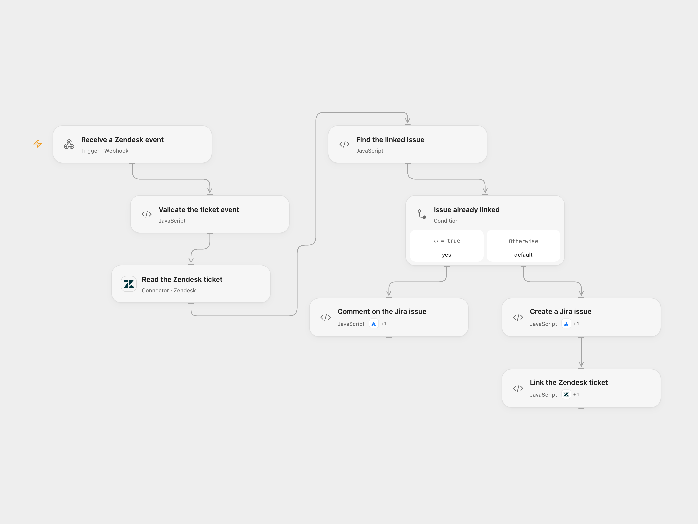

# Create or Comment on Jira Issues from Zendesk

Create a Jira Cloud issue for a Zendesk ticket or add a comment to its linked issue.

<picture>
  <source media="(prefers-color-scheme: dark)" srcset="preview-dark.png">
  
</picture>

[Open Flow JSON](templates/zendesk-ticket-to-jira-issue.openflow.json) · [n8n JSON](templates/zendesk-ticket-to-jira-issue.n8n.json)

## Setup

Create a Zendesk ticket text custom field for the Jira issue key. In **Validate the ticket event**, set its numeric ID and the Jira Cloud project and non-subtask issue type IDs. Connect Zendesk in **Read the Zendesk ticket** and its Action in **Link the Zendesk ticket**, using the same account with ticket read and update access. Connect the same Jira Cloud account in **Create a Jira issue** and **Comment on the Jira issue**, with issue and comment creation access. The Zendesk read Action also reads ticket comments. The ticket's API URL must be on its Zendesk-hosted subdomain.

Create an Open Flow secret Variable named ZENDESK_JIRA_SECRET with at least 24 unpredictable characters and bind it to the secret input of **Validate the ticket event**. Configure the webhook sender to POST JSON containing the ticket ID in id, comment text in comment and the shared value in secret. The shared value is a bearer secret; restrict access to the sender, endpoint and execution history, and use HTTPS. In n8n configure the same field ID, Jira project and issue type in **Validate the ticket event**, credentials on the Zendesk and Jira nodes, and the same secret as the ZENDESK_JIRA_SECRET environment variable accessible to Code nodes. Self-hosted n8n may require enabling environment access. Enable one format only.

## Behavior

The endpoint immediately acknowledges receipt. The workflow validates the secret and reads the ticket. If the configured field contains an issue key, it adds the supplied comment to that issue. The comment is sent as text in a Jira document, may contain Zendesk HTML, and may be visible to anyone with access to the Jira project. Otherwise it creates an issue with the trimmed ticket subject and a link to the ticket, then saves the returned issue key in the ticket field. The creation branch does not add the supplied comment. A missing field, invalid key or empty comment for a linked issue stops the run.

An acknowledgement does not mean the issue or ticket was updated. If issue creation succeeds but the follow-up issue read or ticket update fails, the issue remains unlinked. An uncertain write is not retried automatically; check both systems before rerunning. Concurrent events can create duplicate issues or comments because there is no locking or deduplication.

Inspiration &amp; credits

## Changes to the source

- Replace account-specific IDs and Zendesk URL with user configuration and the returned ticket's host; require a shared webhook secret.
- Validate the ticket, custom field and issue key before writing, and trim the issue summary. The Open Flow Jira Action reads the created issue before linking it; the n8n node checks the issue type before creating it.

Adapted from [Sync Zendesk tickets with subsequent comments to Jira issues](https://github.com/Zie619/n8n-workflows/blob/ae8cf6dc5b873cbb4f74587aa9180ed3a9f70682/workflows/Zendesk/0280_Zendesk_Jira_Create_Webhook.json) in [Zie619/n8n-workflows](https://github.com/Zie619/n8n-workflows). The matching [n8n listing](https://n8n.io/workflows/1833-sync-zendesk-tickets-with-subsequent-comments-to-jira-issues/) credits n8n Team. No separate original template license was found.

The collection’s [MIT notice](https://github.com/Zie619/n8n-workflows/blob/94007c1445d9258a7da116646b79473e7c7c3282/LICENSE) is pinned at a later revision. This is the collection notice at that revision; it does not establish a separate original template author's license. Our changes are listed above; see [repository licensing](../../README.md#licensing).

> MIT License
>
> Copyright (c) 2025 Zie619
>
> Permission is hereby granted, free of charge, to any person obtaining a copy
> of this software and associated documentation files (the "Software"), to deal
> in the Software without restriction, including without limitation the rights
> to use, copy, modify, merge, publish, distribute, sublicense, and/or sell
> copies of the Software, and to permit persons to whom the Software is
> furnished to do so, subject to the following conditions:
>
> The above copyright notice and this permission notice shall be included in all
> copies or substantial portions of the Software.
>
> THE SOFTWARE IS PROVIDED "AS IS", WITHOUT WARRANTY OF ANY KIND, EXPRESS OR
> IMPLIED, INCLUDING BUT NOT LIMITED TO THE WARRANTIES OF MERCHANTABILITY,
> FITNESS FOR A PARTICULAR PURPOSE AND NONINFRINGEMENT. IN NO EVENT SHALL THE
> AUTHORS OR COPYRIGHT HOLDERS BE LIABLE FOR ANY CLAIM, DAMAGES OR OTHER
> LIABILITY, WHETHER IN AN ACTION OF CONTRACT, TORT OR OTHERWISE, ARISING FROM,
> OUT OF OR IN CONNECTION WITH THE SOFTWARE OR THE USE OR OTHER DEALINGS IN THE
> SOFTWARE.

