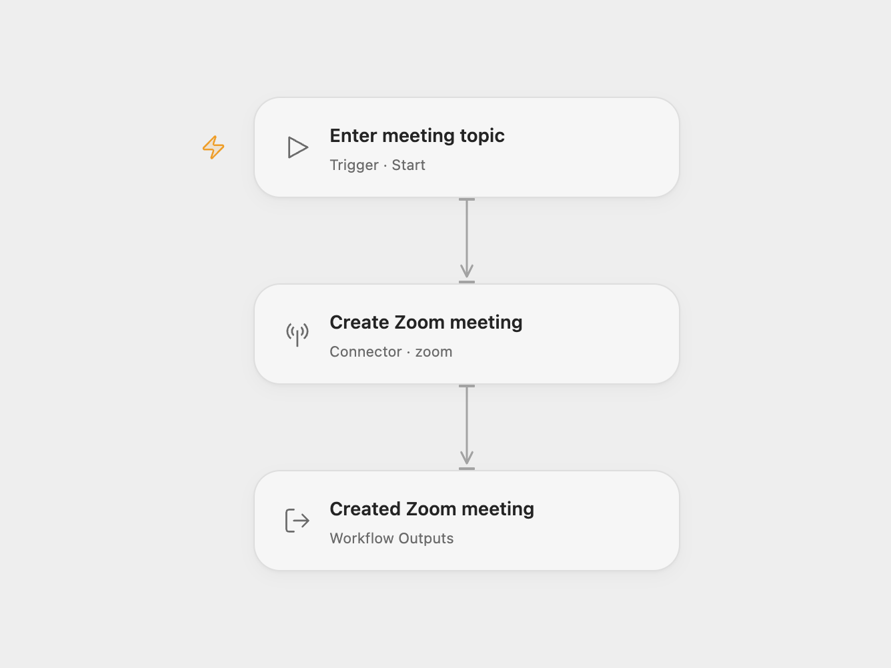

# Zoom Meeting Creator

Create a Zoom meeting for the connected user and return its meeting details and participant join URL.

<picture>
  <source media="(prefers-color-scheme: dark)" srcset="preview-dark.png">
  
</picture>

[Open Flow JSON](templates/zoom-meeting-creator.openflow.json) · [n8n JSON](templates/zoom-meeting-creator.n8n.json)

## Setup

Select a Zoom user OAuth account in **Create Zoom meeting**. The account must be able to host meetings and grant meeting creation access, such as `meeting:write:meeting`. Run with **Topic**. In n8n, choose **OAuth2** credentials and set **Topic** in **Zoom**. Both formats create the meeting for the connected user (`me`).

The template uses Zoom’s scheduled meeting type (`2`) with no start time or duration supplied. Zoom uses the current time when start time is omitted and applies the account’s timezone, meeting settings and security rules. To schedule a future time, configure the Action’s start time, timezone and duration, or the corresponding n8n Additional Fields.

Open Flow returns the normalized meeting and its complete raw record; n8n returns the raw creation response. The result may include a participant join URL, host start URL and passcode. The host start URL normally expires after two hours. No calendar event, participant registration or separate invitation is created by this workflow.

Each run creates another meeting. A failed request stops the run, with no workflow retry or duplicate check. Check Zoom before repeating a request with an uncertain result.

Inspiration &amp; credits

## Changes to the source

- Replace the blank authentication option with OAuth2 in n8n.
- Require the topic as an Open Flow run input.
- Make the scheduled meeting type explicit and expose the meeting result in Open Flow.

Adapted from [Creating a meeting with the Zoom node](https://github.com/Zie619/n8n-workflows/blob/ae8cf6dc5b873cbb4f74587aa9180ed3a9f70682/workflows/Manual/1159_Manual_Zoom_Automation_Triggered.json) in [Zie619/n8n-workflows](https://github.com/Zie619/n8n-workflows). The source export does not identify a separate template author or license.

The collection’s [MIT notice](https://github.com/Zie619/n8n-workflows/blob/94007c1445d9258a7da116646b79473e7c7c3282/LICENSE) is pinned at a later revision. This is the collection notice at that revision; it does not establish a separate original template author's license. Our changes are listed above; see [repository licensing](../../README.md#licensing).

> MIT License
>
> Copyright (c) 2025 Zie619
>
> Permission is hereby granted, free of charge, to any person obtaining a copy
> of this software and associated documentation files (the "Software"), to deal
> in the Software without restriction, including without limitation the rights
> to use, copy, modify, merge, publish, distribute, sublicense, and/or sell
> copies of the Software, and to permit persons to whom the Software is
> furnished to do so, subject to the following conditions:
>
> The above copyright notice and this permission notice shall be included in all
> copies or substantial portions of the Software.
>
> THE SOFTWARE IS PROVIDED "AS IS", WITHOUT WARRANTY OF ANY KIND, EXPRESS OR
> IMPLIED, INCLUDING BUT NOT LIMITED TO THE WARRANTIES OF MERCHANTABILITY,
> FITNESS FOR A PARTICULAR PURPOSE AND NONINFRINGEMENT. IN NO EVENT SHALL THE
> AUTHORS OR COPYRIGHT HOLDERS BE LIABLE FOR ANY CLAIM, DAMAGES OR OTHER
> LIABILITY, WHETHER IN AN ACTION OF CONTRACT, TORT OR OTHERWISE, ARISING FROM,
> OUT OF OR IN CONNECTION WITH THE SOFTWARE OR THE USE OR OTHER DEALINGS IN THE
> SOFTWARE.

