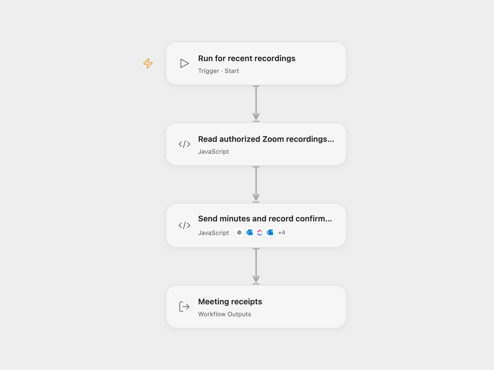

# Summarize Zoom Meetings and Record Follow-ups

Review recent Zoom cloud transcripts, email formal minutes, create the owner’s ClickUp tasks, and calendar a confirmed follow-up.

<!-- template-actions:start -->
 
<!-- template-actions:end -->

<picture>
  <source media="(prefers-color-scheme: dark)" srcset="preview-dark.png">
  
</picture>

## Setup

1. Enable Zoom cloud recording and audio transcription. Create a Zoom Server-to-Server OAuth app on the account that hosts the meetings. Grant the account app the scopes `cloud_recording:read:list_user_recordings:admin` and `meeting:read:list_past_participants:admin`. The app’s owner must be able to view the host’s cloud recording content. Bind `ZOOM_S2S_BASIC_AUTHORIZATION` as a secret variable with `Basic <base64(client_id:client_secret)>`. Set `accountId` and the Zoom user ID `hostId` in **Read authorized Zoom recordings and transcripts**. [Zoom Server-to-Server OAuth](https://developers.zoom.us/docs/internal-apps/s2s-oauth/) · [Zoom Meetings API](https://developers.zoom.us/docs/api/meetings/)
2. In the same settings, enter the owner’s exact spoken name as `ownerName`, an OpenAI `model` with structured outputs, and one `routes` entry per authorized meeting title. Each entry has `title`, `recipient` (one approved attendee’s email), `listId` (the ClickUp list), and `calendarId` (the Outlook calendar). Only include meetings whose attendees permit processing the transcript and sending these minutes.
3. Connect OpenAI, Outlook email, ClickUp and Outlook Calendar in **Send minutes and record confirmed actions**. Use a mailbox authorized to send minutes and accounts with write access to the listed destinations. Publish after configuring the connections and run the published Start manually. Use sandbox connections for draft runs since draft and published runs reserve meetings separately. [Create ClickUp tasks](https://developer.clickup.com/reference/createtask) · [Create Outlook events](https://learn.microsoft.com/en-us/graph/api/calendar-post-events?view=graph-rest-1.0)

## Behavior

The workflow scans the configured host’s scheduled or fixed-time recurring cloud recordings started within the previous 24 hours. It reads each occurrence’s first completed transcript and checks the configured recipient against all pages of that occurrence’s participants. It handles up to 20 list pages and 20 approved recordings per run. Files must be a Zoom-hosted WebVTT transcript of at most 100,000 characters. One redirect to a supported HTTPS Zoom download URL can be followed. Meetings without a ready transcript or a confirmed participant email do not generate writes. Zoom may withhold external participants’ email addresses. Choose an approved attendee whose address Zoom returns.

OpenAI produces formal minutes with a summary, action items and important dates. The workflow emails those minutes to the one configured attendee. Only clearly named owner assignments from the transcript become tasks in the configured ClickUp list. For example, use “Action for Alex Rivera: Share the report by 2027-03-12.” or “Alex Rivera will share the report.” Task due dates are included only when stated as an explicit ISO calendar date. The workflow uses the connected Outlook mailbox to send the summary.

The workflow creates a private Outlook calendar entry only when the final substantive transcript cue is a standalone confirmation, for example, “Confirmed follow-up on 2027-03-12 from 14:00 to 15:00 UTC.” State both times, an explicit time zone and a future date. The appointment must end on the same stated date and run for no more than eight hours. The workflow also accepts “Bestätigter Folgetermin am 2027-03-12 von 14:00 bis 15:00 UTC.” No calendar invitations are sent. Review a suggestion, a later withdrawal or other phrasing manually.

A persistent reservation per Zoom occurrence prevents automatic repeat writes. An uncertain write leaves the reservation in place and stops further writes for that meeting. Check the mailbox’s Sent Items, the ClickUp list, or the Outlook calendar before completing any remaining action manually. Outlook mail acceptance does not confirm inbox delivery.

In n8n

Enter the same settings in **Configure Zoom host and authorized meeting routes**. Attach an HTTP Basic Auth credential with the Zoom client ID and secret to **Obtain a Zoom account access token**. Attach an HTTP Bearer Auth credential for OpenAI to **Extract formal minutes with OpenAI**. Attach ClickUp OAuth2 to **Create tasks in the configured ClickUp list** and Microsoft Outlook OAuth2 to the mail and calendar HTTP nodes. These replace the original SMTP mail transport with the connected Outlook mailbox.

Create a Data Table with a string column named `meeting_key` and select it in **Look up the meeting reservation** and **Reserve this Zoom meeting**. Run one manual execution at a time on a single active copy so lookup and reservation stay serialized. Keep the table across workflow updates. The task node processes the selected owner task items as one batch. If any receipt is missing, other tasks in that batch may already have been created. Check the destination before recovery. The manual run can show a short-lived Zoom access token and meeting content to workflow editors. Restrict workflow and execution access to authorized operators.

Inspiration &amp; credits

Adapted from [Zoom AI Meeting Assistant](https://github.com/enescingoz/awesome-n8n-templates/blob/827110332c21cbe000ab13f6d292d5adb1f1f8db/Other_Integrations_and_Use_Cases/Zoom%20AI%20Meeting%20Assistant%20creates%20mail%20summary%2C%20ClickUp%20tasks%20and%20follow-up%20call.json) in [enescingoz/awesome-n8n-templates](https://github.com/enescingoz/awesome-n8n-templates).

Source collection notice: © 2024–2026 Enes Cingoz, [CC BY 4.0](https://github.com/enescingoz/awesome-n8n-templates/blob/827110332c21cbe000ab13f6d292d5adb1f1f8db/LICENSE). The source credits Friedemann Schuetz. See the [original n8n template](https://n8n.io/workflows/2800-zoom-ai-meeting-assistant-creates-mail-summary-clickup-tasks-and-follow-up-call/). See [repository licensing](../../README.md#licensing) for the scope of OOMOL contributions and third-party material.

The adaptation reads authenticated Zoom cloud recordings by occurrence, replaces an external task worker with in-workflow ClickUp creation, and requires a confirmed calendar time and an approved summary recipient.

