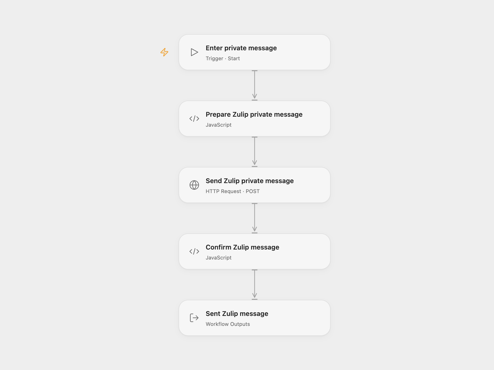

# Zulip Private Message Sender

Send one Zulip private message to one person or to a group of recipients.

<picture>
  <source media="(prefers-color-scheme: dark)" srcset="preview-dark.png">
  
</picture>

[Open Flow JSON](templates/zulip-private-message-sender.openflow.json) · [n8n JSON](templates/zulip-private-message-sender.n8n.json)

## Setup

Create secret Variables for your Zulip user or bot’s API email address and API key. In **Send Zulip private message**, bind **Authentication Username** (`auth.username`) to the email Variable and **Authentication Password** (`auth.password`) to the API key Variable. Replace the URL with your organization’s HTTPS URL followed by `/api/v1/messages`. Both authentication fields use HTTP Basic. Choose the Variables after import; the shared file contains no credentials or Variable bindings.

Run with **Recipients**, an array of Zulip API email addresses, and **Content**, the message text. Use the API email address shown by Zulip, which can differ from a person’s usual email address. The sender needs permission to message these users. In n8n, configure your organization URL, email and API key in Zulip credentials, choose recipients and enter the content in **Zulip**.

Each run sends one message. Multiple recipients receive a single group private message with the sender, rather than separate individual messages. Zulip supports its message formatting in the content. The result includes the message ID and any additional fields the server returns; it does not confirm that anyone has read the message.

The request retains the source’s `private` message type. Zulip still supports this value but recommends `direct` on servers from version 7.0 onward.

The Open Flow HTTP step has a 30-second execution budget. A rejected message, unexpected response or failed request stops the run. Each run can send another message. No duplicate check or automatic retry is configured, so check Zulip before repeating an uncertain request.

## Changes to the source

- Replace blank recipient and content fields with user configuration.
- Use secret Variables for HTTP Basic authentication in Open Flow.
- Check the sent message ID in both formats and expose the full result in Open Flow.

## Source and license

Adapted from [Zulip private message workflow](https://github.com/Zie619/n8n-workflows/blob/ae8cf6dc5b873cbb4f74587aa9180ed3a9f70682/workflows/Manual/0107_Manual_Zulip_Send_Triggered.json) in [Zie619/n8n-workflows](https://github.com/Zie619/n8n-workflows). The source export does not identify a separate template author or license.

The collection’s [MIT notice](https://github.com/Zie619/n8n-workflows/blob/94007c1445d9258a7da116646b79473e7c7c3282/LICENSE) is pinned at a later revision. This is the collection notice at that revision; it does not establish a separate original template author's license. Our changes are listed above; see [repository licensing](../../README.md#licensing).

> MIT License
>
> Copyright (c) 2025 Zie619
>
> Permission is hereby granted, free of charge, to any person obtaining a copy
> of this software and associated documentation files (the "Software"), to deal
> in the Software without restriction, including without limitation the rights
> to use, copy, modify, merge, publish, distribute, sublicense, and/or sell
> copies of the Software, and to permit persons to whom the Software is
> furnished to do so, subject to the following conditions:
>
> The above copyright notice and this permission notice shall be included in all
> copies or substantial portions of the Software.
>
> THE SOFTWARE IS PROVIDED "AS IS", WITHOUT WARRANTY OF ANY KIND, EXPRESS OR
> IMPLIED, INCLUDING BUT NOT LIMITED TO THE WARRANTIES OF MERCHANTABILITY,
> FITNESS FOR A PARTICULAR PURPOSE AND NONINFRINGEMENT. IN NO EVENT SHALL THE
> AUTHORS OR COPYRIGHT HOLDERS BE LIABLE FOR ANY CLAIM, DAMAGES OR OTHER
> LIABILITY, WHETHER IN AN ACTION OF CONTRACT, TORT OR OTHERWISE, ARISING FROM,
> OUT OF OR IN CONNECTION WITH THE SOFTWARE OR THE USE OR OTHER DEALINGS IN THE
> SOFTWARE.
